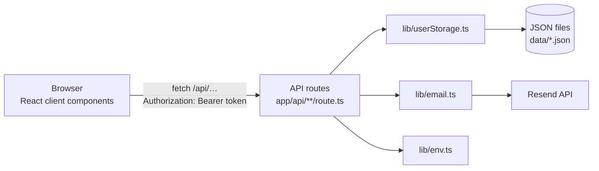

# Architecture

How MediRemind is put together today, and its known limits. This describes the current code, not the plan.



## Pages

All pages are client components.

| Path                         | What it is                                                             |
| ---------------------------- | ---------------------------------------------------------------------- |
| `/`                          | Landing page, built from the sections in `components/`                 |
| `/signup`, `/login`          | Forms, each followed by a 6-digit code step                            |
| `/dashboard`                 | Today's doses, stats, mood check-in; refreshes every 30 seconds        |
| `/dashboard/medications`     | All medications: search, filters, edit, delete, today's doses, history |
| `/dashboard/medications/add` | Add a medication                                                       |
| `/dashboard/upgrade`         | Plans (paid plans are not available yet)                               |

Dashboard pages read the signed-in user with `useStoredUser()` (`lib/useLocalStorage.ts`) and send signed-out
visitors to `/login`.

## Sign-in

1. **Sign up** (`POST /api/signup`): creates an unverified user on the free plan, with the password hashed
   by bcrypt, and emails a signup code.
2. **Verify** (`POST /api/verify`): the signup code marks the account verified.
3. **Log in** (`POST /api/login`): checks the password and emails a login code.
4. **Confirm** (`POST /api/login/verify`): the login code returns a JWT (signed with `JWT_SECRET`, valid for
   7 days, containing `userId` and `email`).
5. The browser stores the token in `localStorage` as `auth_token` (and the user as `user`) and sends it as
   `Authorization: Bearer <token>`. Protected routes are wrapped in `withUser()` (`lib/api/withUser.ts`),
   which verifies the token and looks the user up once for all of them. A missing, expired or forged token,
   or one for a deleted account, gets 401 `unauthorized`.

Codes are 6 random digits, valid for 15 minutes and usable once. A code only works for its own step (signup
or login), and the 5th wrong guess deletes it. `POST /api/resend-code` only issues new signup codes, and only
for unverified accounts. After 5 wrong passwords an email is blocked for 30 minutes, and the count starts
over when the block ends.

In development, codes are also printed to the server log, so sign-in works without an email key.

## Data

> **Moving to Supabase (Phase 3).** The new schema is in `supabase/migrations/`, and the data layer that
> will replace `lib/userStorage.ts` is in `lib/db/`; both are described in [database.md](database.md). The
> local stack is in `supabase/` (see
> [CONTRIBUTING.md](../CONTRIBUTING.md#local-database)). The app switches over once its data layer is in
> place. Until then the JSON files below are the only storage.

`lib/userStorage.ts` keeps everything in JSON files in `MEDIREMIND_DATA_DIR`, or `./data` by default. Each
file holds one object, keyed as follows:

| File                   | Contents              | Key                                            |
| ---------------------- | --------------------- | ---------------------------------------------- |
| `users.json`           | Accounts              | Lowercase email                                |
| `sessions.json`        | Pending sign-in codes | Lowercase email (one code at a time per email) |
| `medications.json`     | Medications           | Medication ID (`med_<time>_<random>`)          |
| `medication_logs.json` | Doses taken           | `<userId>_<medicationId>_<YYYY-MM-DD>_<HH:MM>` |
| `moods.json`           | Daily mood            | `<userId>_<YYYY-MM-DD>`                        |
| `notifications.json`   | In-app notifications  | Notification ID                                |
| `therapy.json`         | Coaching sessions     | Session ID (nothing creates these yet)         |

Every read loads a whole file and every write rewrites it. Files are created on first use. The folder is
excluded from the build's file tracing so it is never bundled into a deployment. Failed-login counts live in
memory, not in a file.

## API routes

| Method and path                             | Login         | Purpose                                               |
| ------------------------------------------- | ------------- | ----------------------------------------------------- |
| `POST /api/signup`                          | No            | Create an account and email a signup code             |
| `POST /api/verify`                          | No            | Verify the account with the signup code               |
| `POST /api/resend-code`                     | No            | Email a new signup code (unverified accounts only)    |
| `POST /api/login`                           | No            | Check the password and email a login code             |
| `POST /api/login/verify`                    | No            | Exchange the login code for a token                   |
| `GET /api/user/profile`                     | Token         | The signed-in user, including their plan              |
| `GET /api/user/streak`                      | Token         | Streak and adherence (placeholder: always 0)          |
| `POST /api/user/upgrade`                    | –             | Always 403 until payments exist                       |
| `POST /api/medications/add`                 | Token         | Add a medication; free plan: 3 medications, no photos |
| `GET /api/medications/list`                 | Token         | The user's medications                                |
| `GET /api/medications/today`                | Token         | One entry per scheduled time today, with its status   |
| `POST /api/medications/mark-taken`          | Token         | Record a dose as taken (see known limits)             |
| `PUT /api/medications/update`               | Token         | Edit one of the user's medications                    |
| `DELETE /api/medications/delete/[id]`       | Token         | Delete one of the user's medications                  |
| `GET /api/medications/history`              | Token         | Doses taken, newest first                             |
| `POST /api/medications/check-completions`   | Token         | Mark the user's finished courses as completed         |
| `GET /api/medications/check-completions`    | `CRON_SECRET` | The same for every user, for a scheduler              |
| `POST /api/mood/log`, `GET /api/mood/today` | Token         | Daily mood                                            |
| `GET /api/notifications`                    | Token         | The user's 10 newest notifications                    |
| `GET /api/therapy/upcoming-session`         | Token         | Next coaching session (none exist yet)                |

## Errors

Every error response has the same body, built by `apiError()` (`lib/api/errors.ts`):

```json
{ "error": { "code": "not_found", "message": "Medication not found" } }
```

`code` is for code to check, `message` can be shown to the user as it is, and some codes add `details`
(for example `retryAfterMinutes` with `too_many_attempts`, which also sets a `Retry-After` header). Each
code always has the same status:

| Status | Codes                                                                |
| ------ | -------------------------------------------------------------------- |
| 400    | `invalid_request`, `invalid_code`, `already_verified`                |
| 401    | `unauthorized`, `invalid_credentials`                                |
| 403    | `email_not_verified`, `upgrade_required`, `payments_unavailable`     |
| 404    | `not_found`                                                          |
| 409    | `email_taken`                                                        |
| 429    | `too_many_attempts`                                                  |
| 500    | `server_error` (unexpected errors; their own message is only logged) |
| 502    | `email_failed`, `sms_failed`                                         |

Every handler runs inside `handleErrors()` (directly, or through `withUser()`), so nothing reaches the
browser as an unhandled exception. Pages read errors with `errorFrom()` (`lib/apiClient.ts`).

## Input and shared types

- Every route that reads a body checks it with `parseJsonBody()` (`lib/validation/request.ts`) and a zod
  schema from `lib/validation/` (`auth.ts`, `medication.ts`, `mood.ts`). Fields a schema doesn't list are
  dropped, so a request can't set an owner, ID or status. Invalid input gets 400 `invalid_request`.
- Emails are trimmed and lowercased. Sign-up enforces the form's password rules; login accepts any
  password so older accounts still work. Medication times must be 24-hour `HH:MM`, dates must be real
  `YYYY-MM-DD` dates, and an end date can't be before the start date (edits are checked after merging).
- `lib/types.ts` holds the shapes shared by storage, routes and pages (`Medication`, `TodayDose`,
  `HistoryEntry`, `Profile`, …). It contains types only, so client components can import it.

## Configuration and email

- `lib/env.ts` validates every environment variable with zod. `instrumentation.ts` runs the check when a
  server starts: `next dev` stops with the list of problems, and `next start` (or Vercel) answers every
  request with an error until they're fixed. `next build` needs no variables.
- `lib/email.ts` sends through Resend. `sendEmail()` never throws and returns whether the email was accepted,
  so routes can tell users when a code couldn't be sent. `escapeHtml()` must wrap user text in email HTML.

## Tests and CI

- `lib/*.test.ts` and `tests/api/*.test.ts` (Vitest) point storage at a temporary folder and mock email.
- `e2e/*.spec.ts` (Playwright) run the production build with `MEDIREMIND_DATA_DIR` set to a temporary folder
  and a fake Resend server (`e2e/fake-resend.mjs`).
- `.github/workflows/ci.yml` runs everything on pull requests; `main` requires it to pass.

## Known limits

| Limit                                                             | Effect                                                                    |
| ----------------------------------------------------------------- | ------------------------------------------------------------------------- |
| JSON files instead of a database                                  | Can't save on Vercel; unsafe with simultaneous writes; slow as data grows |
| Token kept in `localStorage`                                      | Any script running on the page could read it                              |
| Failed-login counts kept in memory                                | Reset on restart and not shared between server instances                  |
| Dates use UTC                                                     | In Nigeria (UTC+1), "today" is still yesterday until 1 a.m.               |
| Today's doses ignore start and end dates and the frequency        | Finished or weekly medications still appear every day                     |
| `mark-taken` reads the medication ID from the dose ID incorrectly | A dose marked as taken shows as not taken after reloading                 |
| No reminders are sent                                             | The core reminder feature doesn't exist yet                               |
