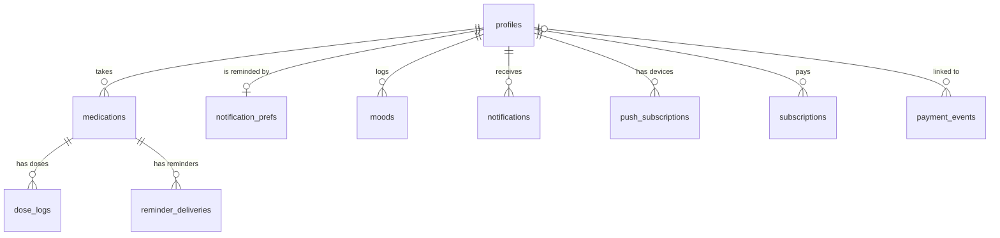

# Database

The Supabase (Postgres) schema the app is moving to in Phase 3. The app still runs on the JSON files
described in [architecture.md](architecture.md) until its data layer switches over (Tasks 36–42).

- Migrations: `supabase/migrations/`, applied in order. Change the schema only by adding one.
- Tests: `supabase/tests/database/*.test.sql` (pgTAP), one file per table plus `schema_rules.test.sql`.
- Run them: `npm run db:start`, then `npm run db:test`. CI applies every migration to an empty database and
  runs the same tests on each pull request.

## Conventions

- **Keys:** `uuid` primary keys from `gen_random_uuid()`. `profiles.id` is the Supabase Auth user's ID.
- **Times:** `timestamptz` for moments (stored in UTC); `date` and `time` for things that are local to the
  person, such as a mood's day or quiet hours, read in `profiles.timezone` (default `Africa/Lagos`).
- **Money:** whole kobo in `integer` columns (`amount_kobo`, `cost_kobo`; 100 kobo = ₦1), as Paystack does.
- **Choices:** `text` with a `check (... in (...))` list rather than Postgres enums, so values can be added
  or removed in a migration.
- **Row level security:** on for every table. Until Task 35 adds policies, only the service role (server
  code) can read or write anything. `schema_rules.test.sql` fails if a table without RLS appears.
- **Ownership:** every row belongs to a profile. Tables that point at a medicine use a composite foreign key
  to `medications (id, user_id)`, so a row can't belong to one person while pointing at another person's
  medicine.
- **`updated_at`:** kept current by the `set_updated_at` trigger on every table that has the column.
- **Deleting an account** deletes everything that belongs to it, except `payment_events`, which are
  financial records and only lose their link to the person.

## Tables

| Table                 | One row per                   | Key rules                                                                                                                       |
| --------------------- | ----------------------------- | ------------------------------------------------------------------------------------------------------------------------------- |
| `profiles`            | Account                       | Phone in E.164 (`+234…`), or email, or both; real time zone; language `en`/`pcm`/`yo`/`ha`/`ig`; plan `free`/`premium`/`family` |
| `medications`         | Medicine someone takes        | Dose as amount + unit; `schedule` JSON with a `type` (shape set by the schedule engine, Task 43); archived rather than deleted  |
| `dose_logs`           | Dose taken, skipped or missed | One per medicine and due time; `taken_at` exactly when taken; where it was recorded (`app`, `whatsapp`, `caregiver`, …)         |
| `moods`               | Day's check-in                | One per person per local day: `happy`, `neutral` or `sad`                                                                       |
| `notifications`       | In-app notification           | Links only to pages inside the app                                                                                              |
| `notification_prefs`  | Account's reminder settings   | Channels, quiet hours, early reminders, when a dose counts as missed, follow-ups, discreet mode; WhatsApp needs an opt-in       |
| `push_subscriptions`  | Browser or phone with push    | Unique `https` endpoint and its encryption keys                                                                                 |
| `reminder_deliveries` | Reminder sent or tried        | Unique per dose, channel, kind and attempt, so nothing is sent twice; status, provider ID and cost in kobo                      |
| `subscriptions`       | Paid plan or pass             | `monthly`/`yearly` renew through Paystack, a `pass` doesn't; one running subscription per person                                |
| `payment_events`      | Paystack webhook event        | Stored once per event; kept when the account is deleted                                                                         |

The comments in each migration explain every column.

## Not in the schema yet

- **Access rules** (row level security policies): Task 35.
- **Creating a profile when someone signs up:** Task 37, with phone sign-in.
- **Family and caregivers** (people managed by someone else, caregiver links and permissions): Phase 7.
  Medicines will gain an optional link to the person they're for; today every medicine is its owner's.
- **Consent records and the audit log:** Phase 8.
