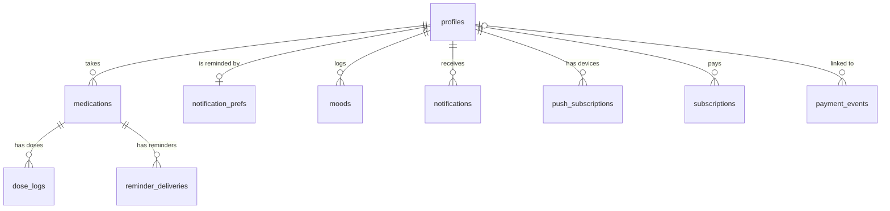

# Database

The Supabase (Postgres) schema the app is moving to in Phase 3. The app still runs on the JSON files
described in [architecture.md](architecture.md) until its data layer switches over (Tasks 36–42).

- Migrations: `supabase/migrations/`, applied in order. Change the schema only by adding one.
- Tests: `supabase/tests/database/*.test.sql` (pgTAP): one file per table, one per table's access rules
  (`*_access.test.sql`), plus `schema_rules`, `isolation`, `free_plan_limit` and `server_only_tables`.
- Run them: `npm run db:start`, then `npm run db:test`. CI applies every migration to an empty database and
  runs the same tests on each pull request.

## Conventions

- **Keys:** `uuid` primary keys from `gen_random_uuid()`. `profiles.id` is the Supabase Auth user's ID.
- **Times:** `timestamptz` for moments (stored in UTC); `date` and `time` for things that are local to the
  person, such as a mood's day or quiet hours, read in `profiles.timezone` (default `Africa/Lagos`).
- **Money:** whole kobo in `integer` columns (`amount_kobo`, `cost_kobo`; 100 kobo = ₦1), as Paystack does.
- **Choices:** `text` with a `check (... in (...))` list rather than Postgres enums, so values can be added
  or removed in a migration.
- **Row level security:** on for every table, with the access rules below. `schema_rules.test.sql` fails if
  a table without RLS appears.
- **Ownership:** every row belongs to a profile. Tables that point at a medicine use a composite foreign key
  to `medications (id, user_id)`, so a row can't belong to one person while pointing at another person's
  medicine.
- **`updated_at`:** kept current by the `set_updated_at` trigger on every table that has the column.
- **Deleting an account** deletes everything that belongs to it, except `payment_events`, which are
  financial records and only lose their link to the person.

## Tables

| Table                 | One row per                   | Key rules                                                                                                                       |
| --------------------- | ----------------------------- | ------------------------------------------------------------------------------------------------------------------------------- |
| `profiles`            | Account                       | Phone in E.164 (`+234…`), or email, or both; real time zone; language `en`/`pcm`/`yo`/`ha`/`ig`; plan `free`/`premium`/`family` |
| `medications`         | Medicine someone takes        | Dose as amount + unit; `schedule` JSON with a `type` (shape set by the schedule engine, Task 43); archived rather than deleted  |
| `dose_logs`           | Dose taken, skipped or missed | One per medicine and due time; `taken_at` exactly when taken; where it was recorded (`app`, `whatsapp`, `caregiver`, …)         |
| `moods`               | Day's check-in                | One per person per local day: `happy`, `neutral` or `sad`                                                                       |
| `notifications`       | In-app notification           | Links only to pages inside the app                                                                                              |
| `notification_prefs`  | Account's reminder settings   | Channels, quiet hours, early reminders, when a dose counts as missed, follow-ups, discreet mode; WhatsApp needs an opt-in       |
| `push_subscriptions`  | Browser or phone with push    | Unique `https` endpoint and its encryption keys                                                                                 |
| `reminder_deliveries` | Reminder sent or tried        | Unique per dose, channel, kind and attempt, so nothing is sent twice; status, provider ID and cost in kobo                      |
| `subscriptions`       | Paid plan or pass             | `monthly`/`yearly` renew through Paystack, a `pass` doesn't; one running subscription per person                                |
| `payment_events`      | Paystack webhook event        | Stored once per event; kept when the account is deleted                                                                         |

The comments in each migration explain every column.

## Who can do what

The app talks to the database as one of three roles:

- **`anon`**: the public key with nobody signed in. It has no access to any table.
- **`authenticated`**: a signed-in person. It reaches only their own rows (row level security) and only the
  columns granted below. Supabase's default grant of everything is revoked first, so a rule like "people
  can edit their profile" can't also let them edit their plan.
- **`service_role`**: server code only, never sent to the browser. It has full access and bypasses row level
  security, so it is used only for what people may not do themselves.

| Table                 | A signed-in person can, for their own rows          | Only the server                                                                  |
| --------------------- | --------------------------------------------------- | -------------------------------------------------------------------------------- |
| `profiles`            | Read; change name, time zone and language           | Create, delete; change phone, email and plan                                     |
| `medications`         | Read, add, edit, archive and unarchive              | Photos, pausing; moving a medicine to someone else is impossible for anyone      |
| `dose_logs`           | Read, record (source `app` or `push`), change, undo | Doses from WhatsApp or SMS replies, caregivers, and marking doses missed         |
| `moods`               | Read, log, change, delete                           |                                                                                  |
| `notifications`       | Read, mark read, clear                              | Create                                                                           |
| `notification_prefs`  | Read, create, change                                | Recording the WhatsApp opt-in                                                    |
| `push_subscriptions`  | Read, register a device, remove one                 | `last_used_at`; moving a device to another account                               |
| `subscriptions`       | Read plan, billing, status, period and price        | Everything else, including Paystack's codes; creating and changing subscriptions |
| `reminder_deliveries` | Nothing                                             | Everything                                                                       |
| `payment_events`      | Nothing                                             | Everything                                                                       |

**The free plan's limit** of 3 active medicines is enforced by a trigger on `medications`, for every role,
server code included. Active means not archived, not paused and not finished (end date before today in the
person's time zone). A paid plan past `plan_expires_at` counts as free. The trigger locks the profile while
counting, so simultaneous inserts can't both slip under the limit, and it refuses with SQLSTATE `P0001` and
the hint `upgrade_required`, the API's error code.

`isolation.test.sql` checks every table a signed-in person can read and fails if any row of someone else's
is visible, or if a readable table has no test data to check.

## The data layer

`lib/db/` is how server code uses the database. The routes switch over to it from the JSON files once
sign-in moves to Supabase (Tasks 37–42).

- **Two clients** (`client.ts`). `dbForUser(accessToken)` acts as the signed-in person, so the rules above
  decide what each request can do; use it for everything people do themselves. `dbAsServer()` uses the
  secret key and bypasses the rules; use it only for what people may not do (`notify`,
  `recordWhatsAppOptIn`, and later payments and reminders).
- **One module per area**: `profiles`, `medications`, `doses`, `moods`, `notifications`,
  `reminder-preferences`. Functions take the client first and return rows typed from
  `database.types.ts`; their input types admit only the columns people may change.
- **Errors** (`errors.ts`). `unwrap()` returns a query's data or throws a `DbError` carrying an API error
  code: the free plan's limit is `upgrade_required` with the database's message, the access rules
  refusing is `not_found` (someone else's row looks like it doesn't exist), and broken table rules are
  `invalid_request`. Routes can let a `DbError` through: `handleErrors()` answers with its code.
- **Writing the same thing twice is harmless.** Recording a dose or a day's mood again replaces it;
  saving reminder settings updates them. These don't use a single upsert, because an upsert rewrites
  every column it sends, including key columns people may not change, and the database refuses it.
- **Types**: after changing a migration, run `npm run db:types` and commit `lib/db/database.types.ts`.
  CI fails if it's out of date.
- **Tests**: `tests/db/*.test.ts`, run with `npm run test:db` against the local stack (`npm run db:start`).
  They create real people through Supabase Auth, sign them in, and delete them afterwards.

## Phone sign-in

Supabase Auth signs people in by phone with a one-time code. The app's routes are ready for the new
sign-in screens (Task 40); until those arrive, the current pages keep the old email sign-in.

1. `POST /api/auth/phone/start` with `{ mode: 'sign_up', phone, fullName }` or `{ mode: 'log_in', phone }`.
   Supabase makes a code and calls the **SMS hook**, `POST /api/auth/sms-hook`, which checks the call's
   Standard Webhooks signature (`lib/webhooks.ts`) and sends the code through Termii (`lib/sms.ts`).
   Signing up passes the name; logging in never creates an account. One code a minute per number.
2. `POST /api/auth/phone/verify` with `{ phone, code }` starts the session and returns the profile. The
   session lives in **httpOnly cookies** (`lib/auth/session.ts`): Secure in production, SameSite=Lax, out
   of reach of the page's JavaScript.
3. When someone signs up, the database creates their profile (`create_profile_for_new_user`), adding the
   `+` Auth leaves off phone numbers. A sign-up with no name is refused.
4. Routes that need a signed-in person use `withSession()`, which asks Auth about the session on each
   request, so a signed-out session stops working at once. `POST /api/auth/sign-out` ends this device's
   session; `GET /api/auth/me` returns the profile.

The code SMS reads "Your MediRemind code is 123456. Don't share it with anyone." and, on a real domain,
ends with the line Android uses to fill the code in (`@domain #123456`).

**Locally**, `supabase/config.toml` sends codes for real numbers to the dev server on port 3000, which
prints them in its log when `TERMII_API_KEY` isn't set. The test numbers `+2348140000001` to `…004` always
take the code `123456` and send nothing; `npm run test:db` signs in with them.

**For the hosted project**, before phone sign-in goes live:

- Supabase dashboard → Authentication → Sign In / Providers → Phone: enable it, with "Confirm phone".
- Authentication → Hooks → Send SMS hook: HTTPS, `https://<the app's domain>/api/auth/sms-hook`. Generate
  its secret and set it as `SMS_HOOK_SECRET` in Vercel.
- Authentication → rate limits and SMS settings: one code a minute, and a code lifetime long enough for
  slow SMS delivery (10 minutes).
- Vercel: `TERMII_API_KEY`, `TERMII_BASE_URL`, `TERMII_SENDER_ID` (the sender ID Termii approved) and
  `TERMII_CHANNEL=dnd`, plus the three Supabase settings.

## Not in the schema yet

- **Family and caregivers** (people managed by someone else, caregiver links and permissions): Phase 7.
  Medicines will gain an optional link to the person they're for; today every medicine is its owner's.
- **Consent records and the audit log:** Phase 8.
